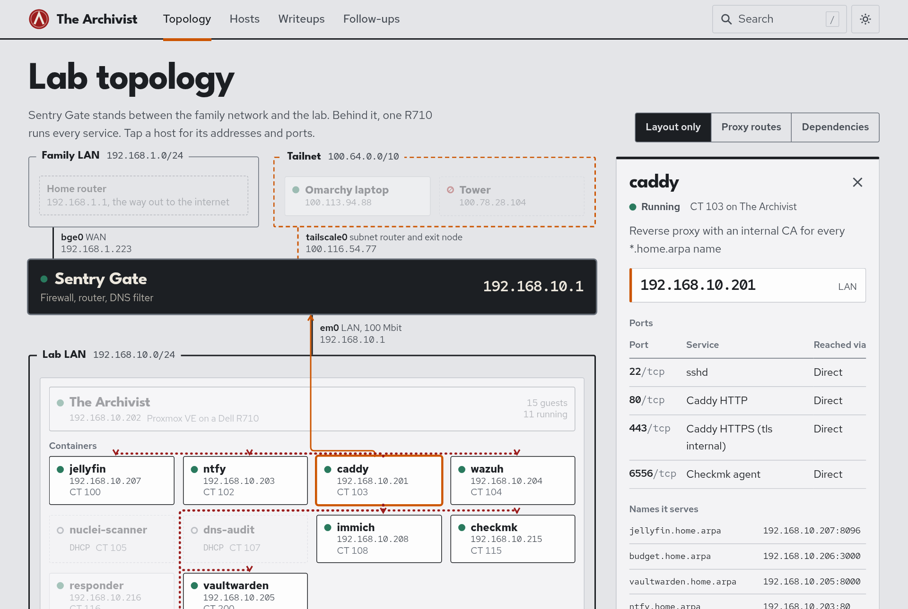

# The Archivist

A two-site security homelab built on second-hand hardware, and the record of how it was built: every host, address and port, and a writeup for every change, incident and fix.

**Browse it: <https://tharold4096.github.io/thearchivist/>** — the topology, a page per host, and every writeup, generated from this repo.

<a href="https://tharold4096.github.io/thearchivist/">
  <picture>
    <source media="(prefers-color-scheme: dark)" srcset="docs/assets/topology-dark.png">
    
  </picture>
</a>

## What this is

A firewall from 2008 and a decommissioned rack server run a small production network for a family (media, photos, file shares, passwords, budgeting) and a security lab on top of it (SIEM, monitoring, an isolated attack range, an alert responder). A dorm desktop at a second site joins over a mesh VPN.

It was built under real constraints: a housing policy that bans network equipment, discontinued residence-hall ethernet, and a shared family network that the lab is not allowed to disrupt. Those constraints shaped the architecture more than any preference did.

| | As of 12 Nov 2026 |
|---|---|
| **Hosts** | 19 documented: 2 physical machines, 10 containers, 5 VMs, 2 clients |
| **Firewall** | OPNsense on a 2008 Dell Inspiron 530: inline router, Unbound DNS filter, Tailscale subnet router |
| **Hypervisor** | Proxmox VE 9.2 on a Dell PowerEdge R710 (24 threads, 94 GiB RAM), powered off overnight and woken by RTC alarm |
| **Detection and monitoring** | Wazuh SIEM, Checkmk across 17 hosts and about 400 services, push alerts through self-hosted ntfy |
| **Automation** | Weekly patch runner with snapshot and hold gates, nightly Proxmox Backup Server jobs, an LLM alert responder gated by phone approval |
| **Record** | 41 writeups, 12 incident records published by the responder, 58 open follow-ups tracked |

## Highlights

Each line links to the full writeup, which shows the diagnosis, the commands and the verification. The numbers are the ones measured in those writeups.

| Work | What it shows |
|---|---|
| [**LLM alert responder with a human in the loop**](https://tharold4096.github.io/thearchivist/writeups/builds/2026-10-13-responder-build-and-live-run/) | Checkmk alerts trigger a sandboxed, read-only Claude diagnosis; a deterministic executor runs the fix only after a one-tap phone approval. SSH forced commands enforce the trust boundary on the targets, atomic state transitions rule out double execution, and every incident is [published to git](https://tharold4096.github.io/thearchivist/writeups/?type=responder). First live outage: alert to verified fix in about 2 minutes, approval included. |
| [**Wazuh SIEM on a firewall, a hypervisor and the container fleet**](https://tharold4096.github.io/thearchivist/writeups/builds/2026-09-02-wazuh-agent-deployment/) | Closed an unauthenticated agent-enrollment path, proved the stock pfSense ruleset was silently discarding every firewall-block alert (2 alerts became 21 once fixed), found one firewall rule producing 69% of 223,000 daily log events, and wrote a bridge daemon that makes DNS-filter blocks searchable in the SIEM. |
| [**Checkmk monitoring with a dependency-aware alert path**](https://tharold4096.github.io/thearchivist/writeups/builds/2026-10-12-checkmk-rollout/) | 17 hosts and about 400 services: TLS-registered agents, a read-only Proxmox API user, SNMPv3 on OPNsense, HTTPS checks through the reverse proxy. Roughly 15 false positives tuned out with scoped, documented rules, so one outage pages once. |
| [**A patch runner that had never patched a container**](https://tharold4096.github.io/thearchivist/writeups/builds/2026-09-15-homelab-update-guest-coverage/) | Audit found all six containers silently skipped and a VM upgrade killed by its own guest agent. Rebuilt it around fail-closed gates (package holds, thin-pool headroom, pre-update snapshots). Day one: 588 package actions, 26.5 GiB of stale thin-pool space reclaimed. |
| [**Booting a modern firewall on 2008 hardware**](https://tharold4096.github.io/thearchivist/writeups/build/2026-07-28-opnsense-legacy-bios-boot/) | OPNsense hung at the BIOS splash. Isolating one variable at a time traced it to a GPT image on a legacy BIOS. The longest troubleshooting sequence in the project, and the most instructive. |
| [**Tamper-evident DNS accountability**](https://tharold4096.github.io/thearchivist/writeups/builds/2026-09-26-omarchy-dns-guard/) | A laptop's DNS pinned to the firewall and failing closed, with a guard that reports any route around it. Separately, [recalibrating a device-compliance correlator](https://tharold4096.github.io/thearchivist/writeups/changes/2026-09-10-correlator-grace-window-calibration/) from 18 reconstructed alert episodes removed all 8 laptop false positives while keeping every true detection. |
| [**An LLM that can only write one field**](https://tharold4096.github.io/thearchivist/writeups/builds/2026-10-28-sure-categorize-responder/) | Bank-transaction categorizer for a self-hosted finance app. The model gets no tools and treats merchant text as untrusted; code validates every proposal and every write is reversible. 307 of 377 transactions categorized on the first run; covered by 14 unit tests and a prompt-injection test. |
| [**Measuring before tuning**](https://tharold4096.github.io/thearchivist/writeups/changes/2026-11-02-sure-page-speed/) | Slow pages in a Rails app, broken down into render, database and GC time. The network, proxy and database were ruled out; the cause was request queueing on a single Puma process. |
| [**This site**](site/README.md) | Generated from the inventory and the writeups' front matter. The build reads only git-tracked files and scans its own output for secrets before it deploys. |

## How the lab is laid out

```text
  Family LAN  192.168.1.0/24              Tailnet  100.64.0.0/10
  home router, family devices             admin laptop, dorm desktop
           │ WAN                                    ┆ subnet route
  ┌────────┴────────────────────────────────────────┴─────────┐
  │  Sentry Gate    OPNsense on a 2008 Dell Inspiron 530       │
  │  firewall, router, DNS filter              192.168.10.1    │
  └────────────────────────────┬───────────────────────────────┘
                               │ Lab LAN  192.168.10.0/24
  ┌────────────────────────────┴───────────────────────────────┐
  │  The Archivist  Proxmox VE on a Dell PowerEdge R710         │
  │  10 containers, 5 VMs                    192.168.10.202     │
  │  ┌ isolated range, no uplink: gateway + vulnerable target ┐ │
  └─────────────────────────────────────────────────────────────┘
```

Family devices connect to the home router directly. They never route through Sentry Gate, never see the lab subnet, and are unaffected if the lab fails. That containment is the most important constraint in the design.

| Purpose | Runs on |
|---|---|
| Edge: firewall, DNS filtering, remote access | [`sentrygate`](hosts/physical/sentrygate/) |
| Reverse proxy with an internal CA, push notifications | [`ct103-caddy`](hosts/lxc/ct103-caddy/), [`ct102-ntfy`](hosts/lxc/ct102-ntfy/) |
| Detection and monitoring | [`ct104-wazuh`](hosts/lxc/ct104-wazuh/), [`ct115-checkmk`](hosts/lxc/ct115-checkmk/), [`ct107-dns-audit`](hosts/lxc/ct107-dns-audit/) |
| Automated response | [`ct116-responder`](hosts/lxc/ct116-responder/) |
| Family services: media, photos, files, passwords, budget | [`ct100-jellyfin`](hosts/lxc/ct100-jellyfin/), [`ct108-immich`](hosts/lxc/ct108-immich/), [`vm101-samba`](hosts/vm/vm101-samba/), [`ct200-vaultwarden`](hosts/lxc/ct200-vaultwarden/), [`vm106-budget`](hosts/vm/vm106-budget/) |
| Backups | [`vm150-pbs`](hosts/vm/vm150-pbs/) |
| Attack range and scanning | [`vm210-range-gw`](hosts/vm/vm210-range-gw/), [`vm211-target-juice`](hosts/vm/vm211-target-juice/), [`ct105-nuclei-scanner`](hosts/lxc/ct105-nuclei-scanner/) |
| Clients | [`omarchy`](hosts/clients/omarchy/) (admin laptop), [`towerofpower`](hosts/clients/towerofpower/) (dorm desktop: AD lab, Kali and Parrot VMs) |

Addresses and ports for all of them are on the [hosts page](https://tharold4096.github.io/thearchivist/hosts/) and in [`hosts/inventory.yml`](hosts/inventory.yml).

## Principles

These came out of the build rather than being decided up front.

**Blast radius over capability.** Every choice is judged on what breaks when it fails. The firewall sits on the lab's network leg, not the household's. A hung firewall costs the lab its internet, not the family theirs.

**Scope discipline.** Sentry Gate routes, filters and resolves. The password vault, monitoring, file sharing and attack targets all live on other hardware. That is what makes a 3 GB machine from 2008 a reasonable firewall rather than a compromise.

**Prove the way back in before closing the door.** Remote access was installed and verified from off-network before any change that could remove local access.

**Fail closed, and let code decide.** Patch gates stop the run when a check can't be made. The responder's model can read and propose; only deterministic code can act, and only after approval.

**Written down, then checked live.** Each writeup carries the date its claims were last verified against the running system, and lists what is still open instead of calling the work finished.

## What's in the repo

```text
hosts/                 one folder per machine: summary README + every config deployed on it
  inventory.yml        machine-readable inventory (IPs, ports, roles, dependencies)
  physical/            sentrygate (OPNsense firewall), thearchivist (Proxmox host)
  lxc/ctNNN-name/      Proxmox containers by VMID
  vm/vmNNN-name/       Proxmox VMs by VMID
  clients/             omarchy (admin laptop), towerofpower (dorm desktop)
docs/
  writeups/            one doc per piece of work: builds/ changes/ updates/ incidents/
  build/               the July 2026 build-out series
  overview/            architecture, project plan, background investigations
  templates/           the template for each writeup type + front-matter rules
journal/responder/     incident records the responder publishes automatically
site/                  the Astro site, generated from everything above
.github/workflows/     builds and deploys the site on every push to main
```

| Start with | What's in it |
|---|---|
| [`docs/overview/network-architecture.md`](docs/overview/network-architecture.md) | Why the lab sits behind its own firewall: constraints, addressing, DNS hardening, what was deliberately left out |
| [`docs/writeups/README.md`](docs/writeups/README.md) | Every writeup, newest first, with status and open follow-ups |
| [`hosts/README.md`](hosts/README.md) | Every machine with its address, ports and role |
| [`hosts/lxc/ct116-responder/DESIGN.md`](hosts/lxc/ct116-responder/DESIGN.md) | The responder's trust boundary, approval flow and learned approvals |
| [`docs/build/2026-07-27-build-log.md`](docs/build/2026-07-27-build-log.md) | The initial build, session by session: what was decided, what was ruled out and why |

### How the docs work

Every writeup starts with front matter (`type`, `date`, `hosts`, `tags`, `status`, `verified`, `open`) and follows the template for its type in [`docs/templates/`](docs/templates/). `verified` is the date the content was checked against the live system, not the date it was edited. `open` counts the unchecked follow-ups in the file. The site, the host pages and the indexes are all generated from that metadata, so the docs and the site cannot drift apart.

Secrets never live here. Credentials and ntfy topic names are `<SET-ON-HOST>` placeholders, and each file names the host-side path that holds the real value. Some media-automation hosts are documented locally only and are not part of this repo.

## Still open

The lab is not finished and the docs say so. All 58 open items are on the [follow-ups page](https://tharold4096.github.io/thearchivist/follow-ups/), each linked to the writeup that raised it. A few of them:

- The firewall's LAN interface is 10/100 only, which caps the lab at about 90 Mbit/s; a gigabit NIC is undecided.
- The responder re-diagnoses a flapping alert every time; flap suppression is proposed but not built.
- A broad Tailscale pass rule on the firewall shadows the narrower per-device rules.
- Host status on the site is a dated snapshot; a live feed is deferred to a later pass.

## Built with

OPNsense, Unbound, Tailscale, Proxmox VE, LXC, LVM-thin, Proxmox Backup Server, Wazuh, Checkmk, SNMPv3, Caddy, ntfy, nftables, systemd, Docker, Python, Bash, Claude, Astro, GitHub Actions.
